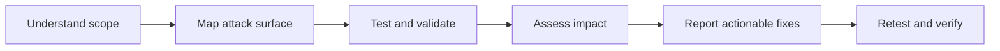

# Hi, I'm Priyanshu Yadav 👋

### Cybersecurity Professional | Web, API & Mobile Security | VAPT | Active Directory | DevSecOps | Cloud Security | AI/LLM Security

I'm **Priyanshu Yadav**, a cybersecurity professional with hands-on experience in **penetration testing, vulnerability assessment, and security risk management**.

My experience includes assessing **100+ government and enterprise web applications**, conducting infrastructure security assessments, validating vulnerabilities, developing proof-of-concept demonstrations, and collaborating with technical teams on remediation and security improvements.

My technical interests span **Web and API Security, Android Application Pentesting (Static & Dynamic Analysis), Active Directory Security, and Infrastructure Security**. I'm also expanding my knowledge of **DevSecOps, Cloud Security, and AI/LLM Security**, exploring how security can be integrated into modern applications, infrastructure, and development workflows.

I enjoy understanding how systems work, identifying where security controls can fail, and translating technical findings into practical improvements. I approach cybersecurity with a focus on **continuous learning, hands-on experimentation, and solving real-world security challenges**.

---

## 🔎 What I bring to security teams

- **Application security:** Black-box and grey-box web application testing, API security fundamentals, OWASP-aligned testing, manual verification, and actionable remediation guidance.
- **Mobile application security:** Android static and dynamic testing, APK inspection, runtime instrumentation, traffic interception, and analysis of client-side security controls using MobSF, JADX, ADB, Burp Suite, and Frida.
- **Infrastructure and Active Directory:** Vulnerability assessment of servers and network assets; knowledge of AD pentesting concepts, authentication, enumeration, and common misconfiguration risks.
- **Evidence-driven reporting:** CVSS v3.1 severity assessment, CWE mapping, proof-of-concept evidence, false-positive validation, and retesting after fixes.
- **Security engineering mindset:** Interested in moving security earlier into development workflows, reducing repeat findings, and making secure defaults easier for teams.

## 🧭 Focus areas

| Established hands-on experience | Expanding specialization |
| :--- | :--- |
| Web application VAPT and API testing | **DevSecOps:** CI/CD security, SAST/DAST/SCA, secrets scanning, IaC and container security |
| Infrastructure vulnerability assessment | **Cloud Security:** AWS/Azure IAM, configuration review, logging, network controls, and cloud threat modeling |
| Android mobile VAPT — static and dynamic analysis | **AI Security:** OWASP LLM Top 10, prompt injection, data leakage, RAG and agent security testing |
| Active Directory pentesting knowledge | **Security automation:** Python/Bash tooling, repeatable checks, and security gates |

> The right column represents areas I am actively developing, not a claim of production deployment or professional specialization.

## 🛠️ Technical toolkit

**Offensive security & assessment**  
`Burp Suite` · `OWASP ZAP` · `Nmap / NSE` · `Nessus` · `OpenVAS` · `Nikto` · `Metasploit` · `Responder` · `Wireshark`

**Mobile security & analysis**  
`MobSF` · `JADX` · `Frida` · `ADB` · `Burp Suite` · `Apktool` · `Android Emulator` · `Android Studio` · `Objection` (learning)

**Mobile testing workflows**  
`APK decompilation & manifest review` · `Permissions and exported components` · `Hardcoded secrets and insecure storage` · `Dynamic instrumentation` · `HTTP(S) traffic interception` · `SSL/TLS pinning assessment` · `Runtime behavior validation`

*Core mobile tools and workflows reflect my stated skills; Objection is listed as a learning tool.*

**Systems, scripting & foundations**  
`Kali Linux` · `Git` · `Python (basic)` · `Bash` · `TCP/IP` · `DNS` · `HTTP/HTTPS` · `AWS/Azure fundamentals`

**Standards & methodology**  
`OWASP Top 10` · `OWASP WSTG` · `PTES` · `OSSTMM` · `CVSS v3.1` · `CWE` · `NIST` · `ISO/IEC 27001`

**Current learning roadmap**  
`GitHub Actions / CI/CD` · `Semgrep / CodeQL` · `Trivy / Dependency Scanning` · `Docker / Kubernetes Security` · `Terraform / IaC Scanning` · `Cloud IAM` · `LLM Threat Modeling` · `Prompt Injection Testing`

*Roadmap tools are learning targets, not asserted professional proficiency.*

## 🚀 Featured repositories

<table>
<tr>
<td width="50%" valign="top">

### 🌐 [Web Application Pentesting](https://github.com/Py912/Web-Application-Pentesting)

Structured learning notes and testing references spanning web application security, vulnerability classes, testing approaches, and remediation.

[Explore repository →](https://github.com/Py912/Web-Application-Pentesting)

</td>
<td width="50%" valign="top">

### 📱 [Android Pentesting](https://github.com/Py912/Android-Pentesting-)

Android security notes covering static APK analysis, dynamic testing, runtime instrumentation, traffic inspection, and common mobile application risks.

[Explore repository →](https://github.com/Py912/Android-Pentesting-)

</td>
</tr>
</table>

## 🧪 How I approach an assessment

## 📌 Selected experience highlights

- Assessed **100+ web applications** in government and enterprise environments using manual and automated techniques.
- Conducted infrastructure assessments using **Nessus and Nmap/NSE**, including vulnerability validation and false-positive review.
- Produced reports with **CVSS v3.1 scoring, CWE classification, proof-of-concept evidence, and remediation recommendations**.
- Coordinated with technical stakeholders on vulnerability closure and **post-remediation verification**.

## 🎓 Education

- **Post Graduate Diploma in Cyber Security and Law** — Shaheed Sukhdev College of Business Studies, University of Delhi
- **B.Sc. (Hons.) Computer Science** — University of Delhi

## 🤝 Let's connect

I enjoy connecting with security practitioners, developers, and researchers to exchange ideas about **application security, mobile testing, secure development, cloud security, and AI system security**.

📍 New Delhi, India · [LinkedIn](https://www.linkedin.com/in/priyanshu-yadav-csec) · [Email](mailto:priyanshuyadav57033@gmail.com)

---

Built around practical security work, continuous learning, and responsible disclosure.

